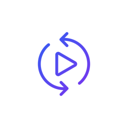
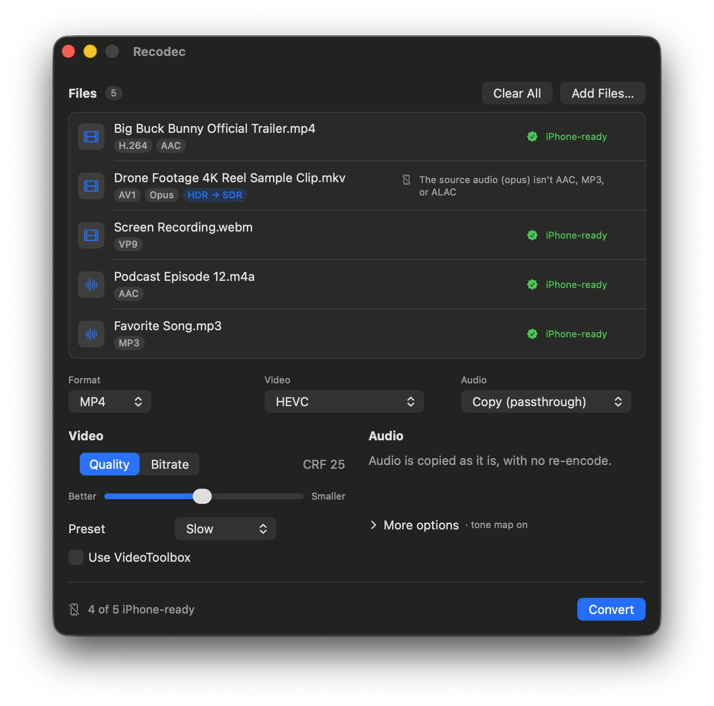

<div align="center">



# Recodec

**A simple, native macOS media converter — right-click to convert video and audio into iPhone-friendly formats, powered by ffmpeg.**



</div>

## Why I built this

macOS already puts an "Encode Selected Video Files" item in the Finder right-click menu, but it's built on AVFoundation (Apple's `avconvert`), which only understands a narrow set of codecs and containers. Hand it an MKV, a WebM, an AV1 or VP9 video, or many common audio formats and it simply won't touch them — there's nothing it can do with those files.

ffmpeg, on the other hand, reads and writes almost anything. Recodec keeps the convenience of a Finder right-click but backs it with ffmpeg, so the formats Apple's converter can't open or produce just work: select files, right-click **Convert Media** (or drag them onto the window), pick a target format, and go.

## Features

- **Right-click "Convert Media"** in Finder (a macOS Service), plus drag-and-drop and an Add Files… picker.
- **Batch convert** with per-file progress.
- **Containers:** MP4, MOV, M4V, MKV, WebM, M4A, MP3, GIF, FLAC, WAV.
- **Video:** H.264, HEVC, AV1, VP9, ProRes — or **Copy** (passthrough, no re-encode).
- **Audio:** AAC, MP3, ALAC, Opus, FLAC, PCM, AC-3, E-AC-3 — or Copy.
- **Controls:** per-codec quality (CRF), encoder preset, channels (up to 7.1 where the encoder supports it), audio bitrate (up to 1536 kbps), and optional VideoToolbox hardware encoding.
- **Keep all audio and subtitle tracks** (opt-in, under **More options**) — carry every audio and subtitle stream through (and attachments, into MKV) instead of one of each, transcoding only the first audio track.
- **HDR → SDR tone mapping** — iPhone and macOS screen recordings in HDR (PQ/HLG) look washed out once shared; Recodec detects them, marks them with an **HDR → SDR** chip in the file list, and tone maps to Rec.709 on VideoToolbox.
- **Live iPhone-ready verdict, per file** — each row says whether that file comes out iPhone-ready under your current settings (and why not), and the footer counts them ("2 of 4 iPhone-ready"). With **Copy** the answer depends on the source, so a batch can mix both.
- Only codec/container combinations ffmpeg can actually mux are offered (the matrix is verified against ffmpeg, not guessed).
- **Reasons, not "Conversion failed!":** when ffmpeg cannot convert a file, its row shows the first error ffmpeg logged (the muxer's own sentence), or, for a track the container cannot hold, which track and what to do.

## Multi-track sources

By default Recodec lets ffmpeg pick the streams, which means **one video, one
audio, and one subtitle track** — ffmpeg's standard stream selection. For a
single-track source that is exactly right, and it stays the default so existing
conversions produce byte-identical output.

A disc remux is usually not a single-track source. Open **More options** and turn on
**Keep all audio and subtitle tracks** and Recodec maps every video, audio and subtitle stream from the input
instead (plus attachments such as fonts, into MKV), copying subtitles through
(text ones are converted where the container needs another format, see below).
Chapters are carried through either way, wherever the container can hold them.

Two things to know:

- Streams are mapped by kind, and a few tracks a container cannot hold are left
  out rather than aborting the run: data tracks (the timed-metadata tracks on
  iPhone clips, the text track MP4 uses for chapters — the chapters themselves
  are kept), cover art when the video is re-encoded, and attachments outside
  MKV. With video **Copy** cover art is passed through: MP4 keeps it as a
  picture, MKV stores it as a one-frame video track and MOV drops it. Audio
  tracks after the first are copied as they are, so one the container cannot hold
  (an AC-3 track into WebM) is refused before ffmpeg starts, naming the track;
  the same goes for a copied first track. MP3, FLAC and WAV hold exactly
  one audio track, so they get the first; M4A keeps them all. GIF ignores the
  setting.
- Text subtitles are converted to the format the container holds, so they never
  stop a run: `mov_text` for MP4, MOV and M4V, WebVTT for WebM, SubRip for MKV
  (which keeps SubRip, ASS and WebVTT as they are, so styled ASS stays styled).
  Converting to `mov_text`, WebVTT or SubRip drops ASS styling. Bitmap subtitles
  cannot become text: PGS is kept by MKV only, and a file with a PGS track is
  refused for the other containers before ffmpeg starts, naming the track — use
  MKV for disc remuxes. Other bitmap formats (VobSub, DVB) are copied as they
  are, and ffmpeg decides whether the container takes them.
- **Default subtitle** sets which subtitle track a player selects on its own. It
  needs *Keep all audio and subtitle tracks*, because without mapping there is at most one subtitle
  track to flag. Picking a language clears the *default* flag on every subtitle
  stream first (other flags such as *forced* are kept in MKV and MP4; MOV and M4V
  drop them when the subtitles are copied), then sets it on the first track
  matching that language — so a source shipping two "default" tracks does not
  carry the conflict through. The two ISO 639-2 codes some languages have
  (`ger`/`deu`, `fre`/`fra`) match each other. The MP4-family muxers re-enable the
  first subtitle track when none is flagged, so *None* would move the default to
  that track instead of clearing it: it is offered for MKV and WebM only. Leave it
  on *Unchanged* to preserve whatever the source declared.

### Lossless and HD audio

The bitrate list goes up to 1536 kbps and channels to 7.1, which matters when a
playback target cannot decode the source codec. The Plex tvOS client, for
example, only Direct Plays `aac`, `ac3`, and `eac3` — hand it TrueHD or FLAC and
the server transcodes, typically down to 640 kbps E-AC-3. Pre-encoding the track
yourself to E-AC-3 at 1536 kbps avoids the server-side transcode and keeps
considerably more of the source than the automatic one would.

The channel picker only offers what the selected encoder accepts, because ffmpeg
aborts on an unsupported layout rather than down-mixing. AC-3 and E-AC-3 stop at
5.1 (7.1 Dolby Digital Plus needs Dolby's own encoder, which ffmpeg does not
ship), MP3 is stereo-only, and ALAC is capped at 5.1 here — its 8-channel layout
is `7.1(wide)`, which routes the side channels to front-wide speakers and would
mislabel a standard 7.1 mix. AAC, Opus, FLAC and PCM take the full 7.1. The bitrate
picker follows the same rule, because what an encoder takes depends on the codec and
the layout: MP3 stops at 320 kbps and AC-3 at 640 (higher requests are silently
clamped), E-AC-3 goes up to 1536, Opus takes 256 kbps per channel (mono 256, stereo
512, 5.1 and 7.1 up to 1536) and AAC keeps its 640 up to stereo, with the 768+
presets for surround. With *Same as source* the picker keeps the whole list, since a
batch can mix layouts. Only Opus refuses a bitrate, so only an Opus request is lowered
to what the file's own channel count takes (a mono source asked for 512 kbps gets 256
instead of a failed run; a request is never raised); MP3 and AC-3 clamp inside ffmpeg
and AAC takes what it is given. With several audio tracks the count is that of the track
ffmpeg encodes: the one flagged default, else the one with the most channels (a track
that only starts after ffmpeg's probe window is not noticed), or the first when every
track is kept. Changing codec or channels clamps an out-of-range selection down rather
than failing at convert time.

For genuinely lossless output, pair **Video: Copy** with **Audio: FLAC** in MKV:
the video is passed through untouched and the audio is re-encoded without loss
(ffmpeg's TrueHD decoder is bit-exact, and FLAC stores an MD5 of its source PCM
so you can verify the result).

With *Keep all audio and subtitle tracks* on, only the **first** audio track is transcoded; the rest
are copied. A disc remux that ships a lossless primary track plus an AC-3
compatibility track keeps that second track byte-for-byte instead of re-encoding
it lossy-to-lossy at the primary track's bitrate.

## HDR sources

iPhones record Dolby Vision / HLG by default, and the macOS Screenshots app
records the screen in HDR (PQ, BT.2020, 10-bit) on an HDR-capable display.
Both play back fine on the device that made them, but the moment such a clip
is re-encoded without care — or just viewed on an SDR screen — the BT.2020
pixels get interpreted as Rec.709 and the picture goes flat and grey.

Recodec reads the video's transfer function when a file is loaded, from the stream
and from the first decoded frame (HLG can be signalled only inside the bitstream, where
the stream entry never shows it). If it
is PQ or HLG the **Tone map HDR to SDR** toggle (under **More options**) switches itself on, and the
conversion runs Apple's own tone mapper (`scale_vt`, the one QuickTime uses)
on VideoToolbox before encoding: H.264 and HEVC are decoded in hardware, other
codecs by ffmpeg, and the frames are then uploaded to the GPU for the mapping
step. The output is tagged Rec.709
throughout and the HDR mastering / content light level metadata is stripped,
so players do not re-flag it as HDR. The *ambient viewing environment* side data some
iPhone clips carry is not an HDR flag and is left as it is.

Notes:

- Tone mapping needs the video re-encoded; with video **Copy** the Video column says
  so and the toggle is not shown.
- The toggle switches itself *on* when the list goes from having no HDR file to
  having one, and is never switched off automatically, so a manual choice
  survives adding more files to the batch.
- Only HDR files are tone mapped. SDR files in the same batch are converted
  exactly as they would be with the toggle off.
- The mapping runs in 10-bit 4:2:0: a 4:2:2 or 4:4:4 HDR source (ProRes) is chroma
  subsampled on the way through, even when the output codec is 4:2:2 again, and
  an alpha channel is dropped.
- It needs an ffmpeg that includes the `scale_vt` filter (the Homebrew build
  does; check with `ffmpeg -filters | grep scale_vt`). Recodec asks ffmpeg for its
  filters at launch; without `scale_vt` the toggle stays off and is disabled with a
  note, and HDR files are converted without tone mapping.
- If you mostly record for sharing, turn HDR off at the source instead:
  Screenshots app → Options → HDR, or iPhone Settings → Camera → Record Video →
  HDR Video.

## Requirements

- macOS 13 (Ventura) or later
- [`ffmpeg`](https://ffmpeg.org/) installed on your machine (see below)

## Install ffmpeg (required)

Recodec needs `ffmpeg` and `ffprobe` available on your system:

```sh
brew install ffmpeg
```

Recodec checks for ffmpeg on launch and shows a hint if it's missing.

### Why isn't ffmpeg bundled?

Recodec is a thin, native front-end: it builds ffmpeg commands and shows you the results — it doesn't reimplement any encoding. Shipping ffmpeg *inside* the app is deliberately avoided, because:

- **ffmpeg moves fast.** Installing it through Homebrew means you get the newest codecs, fixes, and hardware support on ffmpeg's schedule — not whenever a bundled copy happens to be updated.
- **Licensing.** A full ffmpeg build (with x264/x265) is GPL; redistributing it inside an app pulls in licensing and notarization obligations that don't belong on a small tool. Recodec just *invokes* ffmpeg as a separate program, so its own code stays unencumbered.
- **Size & trust.** The app stays tiny, and you run the same ffmpeg you already trust rather than an unknown binary baked into someone else's bundle.

The trade-off is one extra step — `brew install ffmpeg`. Realistically, if you'd reach for a tool like this, you almost certainly have it already.

## Usage

1. **From Finder:** select one or more media files → right-click → **Convert Media**.
2. **Or:** open Recodec and drag files in, or click **Add Files…**.
3. Choose a format, codec, and quality; keep an eye on the **iPhone-ready** badge.
4. Click **Convert**. Converted files are written next to the originals.

Files can be removed individually or with **Clear All** while metadata is loading. Results arriving after a file is removed are ignored.

## Build from source

Recodec uses [XcodeGen](https://github.com/yonaskolb/XcodeGen) to generate the Xcode project, and keeps its logic in a Swift package (`MediaConverterCore`) covered by tests.

```sh
brew install xcodegen ffmpeg
xcodegen generate          # creates Recodec.xcodeproj (git-ignored)
open Recodec.xcodeproj      # build & run in Xcode

# run the core tests
cd Packages/MediaConverterCore && swift test
```

## License

Recodec's own source is released under the MIT License. ffmpeg is separate software under its own license (LGPL/GPL) and is **not** bundled — Recodec calls the copy you install.
